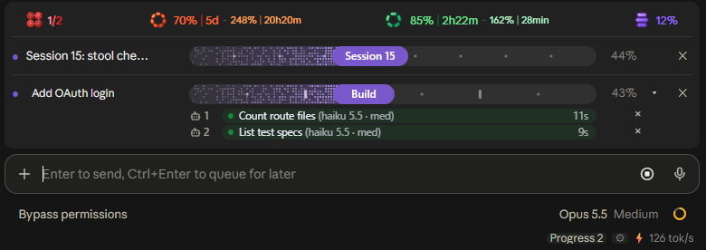
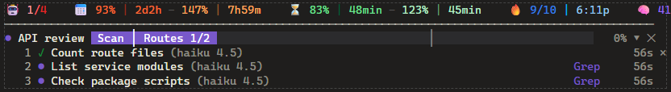

<div align="center">

# 🪑 stool

### **S**TOOL is **T**ools for **O**rchestration and **O**ptimizing **L**imits

<sub>(Salem's TOOLs)</sub>

[](LICENSE)
[](https://claude.com/claude-code)


**Live progress bars, a usage strip and an agent cap above your Claude Code prompt,<br>so long multi-agent sessions stay visible and stay inside your limits.**



<sub>In the Claude desktop app: usage strip, two plan bars, per-agent rows, and the Progress button and tok/s beside the model.</sub>

</div>

## What you get

- 📊 **Progress bars** that the model keeps itself: staged plans, the active stage as a pill, one row per subagent with its model, tool and time.
- 🚦 **Usage strip**: running agents against the cap, weekly and 5-hour usage with where you are on pace to land, context %, tokens per second.
- 🧮 **Agent cap** that follows your pace, so the model knows how many expensive agents it can run right now.
- 🔥 **Keep-warm**: pings a big idle session so its one-hour prompt cache doesn't go cold while you're away.
- 🔁 **Restart tools**: a clock that says when the context is due a restart, and a tool that clears and resumes the same session.
- 🛡️ **Opt-in guards** for the main conversation, agent dispatch and slow capture tools, all pattern-driven, nothing tied to one project.
- 🧰 **Workflow skills**: project setup (handoff, TODO, fix log), catch-up recaps, adversarial review, arenas, hill-climbing, autonomous runs, handoffs.

It draws in the terminal too:



The generic parts are on as soon as you install it. The guards that carry project-specific rules are off until you switch them on in `/config` (or the progress bars' ⚙ settings window), and their patterns and paths are options.

## Install

Inside Claude Code (desktop app or terminal):

```
/plugin marketplace add s66lem/stool
/plugin install stool@stool
```

Or from a shell:

```
claude plugin marketplace add s66lem/stool
claude plugin install stool@stool
```

This installs the version on `main` (2.19.0, the one in the badge above); `claude plugin list` shows what you have. To move an older install up to it:

```
claude plugin marketplace update stool
claude plugin update stool@stool
```

A running session keeps the version it started with, so restart Claude Code afterwards. Pick a scope when asked, then set the options (every one has a default). Needs Claude Code 2.1.275 or later. The options live in `/config` under the plugin's name and can also be edited in `settings.json` under `pluginConfigs`.

## Parts

| Part | On by default | What it does |
| --- | --- | --- |
| Progress bars (`plan-progress`) | yes | The `plan_progress` tool: the model keeps a staged plan above the prompt, with per-agent strips, a stage pill, times on hover, sounds, and a settings window (the gear in the footer). The terminal bar is a braille track. |
| Usage strip | yes | A strip above the bars: running agents / agent cap (`1+2/4` is one cheap Haiku agent plus two counted Sonnet/Opus against a cap of four), weekly and 5-hour usage with the pace, keep-warm state, context percent, tokens per second. |
| Usage pace (`usage-pace`) | yes | Computes the agent cap from the 5-hour and weekly windows, and toasts when the 5-hour limit would be hit early. Tool `agent_cap`. |
| Weekly burn (`burn-pace`) | with `usageLog` | `/burn` (or Show on the settings window's Weekly burn row) draws this week's weekly % against an even pace, the week-average and last 1/6/24 h pace projections, when it runs out, and an hourly pts/hr strip against the rate that lasts to the reset; hover an hour for its numbers. |
| Keep-warm (`keep-warm`) | yes | Pings a big idle session every 50 minutes so its one-hour prompt cache stays warm, up to 15 pings in a row, only above 100k tokens of context and below 95% of any limit. Command `/keepwarm off\|on\|<count>`. |
| Restart tools (`fresh-restart`) | yes | `restart_session` (`/clear` plus a resume prompt in the same session, once the turn ends, or `/compact` plus injected resume context with `restartMode` compact; a review tier due at this restart goes in front of the prompt, see `reviewTiers`) and `reload_plugins`. |
| Restart clock (`restart-clock`) | context part: yes | Says (a note on a tool result, red on the strip) when the main conversation reaches `restartContextTokens` (or the legacy `restartContextAt` percent, whichever comes first). Opt-in extras: a publish counter and a handoff-file lint. |
| Agent meter (`agent-meter`) | yes | Counts each subagent's tool calls against the cap its prompt states ("about 40 tool calls"), toasts once over it, and appends one line per finished agent to a ledger file (with its four token counts, id and session). Tools `usage_since` and `outcomes` (weekly % and commits per project, and the cost of one commit). |
| Dispatch guard (`dispatch-guard`) | no | Appends standing orders to every Agent prompt, can require a tool-call cap on prompts matching a pattern, and holds expensive agents to the agent cap across all your sessions (through a shared slot file; Haiku and `dispatchCheapAgents` types are not counted, and an agent resumed with SendMessage takes its slot again). |
| Permission command (`permission`) | no | `/stoolpermission <mode> [--persist]`: set the session's permission mode where the client's picker lacks one (bypass over Remote Control on a phone). `bypassPermissions` is done by turning `ask` into `allow` (deny rules and guards still apply); `default`, `acceptEdits`, `auto` and `dontAsk` are the real modes, set at the next permission prompt. `--persist` holds the project folder and below to the mode, for every session there, until `/stoolpermission off --persist`. |
| Lead guard (`lead-guard`) | no | Denies known slips of the main conversation (not subagents): `git add -A`, `cd` out of the project folder, shell writes to chosen doc paths, check scripts piped to `tail`, plus a nudge after repeated full-size image reads. |
| Capture guard (`capture-guard`) | no | Circuit breaker on a slow screen-capture tool (stops after two failures in a row) and a strip value with free RAM and the count of the watched app's windows. Windows only for the strip. |

Tools can go missing in a session that resumed after a reboot (their registration ran before the session was bound). At every prompt stool checks the model's tool list and offers again whichever of `agent_cap`, `restart_session`, `reload_plugins`, `usage_since`, `outcomes` and `keep_warm` is missing; a re-offered tool shows from the next prompt.

## Options

All options are plugin `userConfig` fields. Lists are lists of strings; "regex source" fields take the text of a JavaScript regular expression (an invalid one matches nothing).

| Option | Default | What it does |
| --- | --- | --- |
| `projectRoots` | empty | Folders (with their subfolders) where the folder-scoped parts run: keep-warm, agent-meter, restart-clock, and the guards. Empty = every folder. |
| `doneBarSeconds` | 30 | Seconds a finished progress bar stays while auto-close (`/plan-progress-autoclose`) is on. |
| `twinkle` | true | Animate the dots of the terminal bar while Claude works. |
| `planProgress` | true | The progress bars. Off: no bars or agent strips drawn, no Progress button in the footer, no `plan_progress` tool, no prompt rules, reminders, edit gate or Stop block, so the model makes no extra calls: the tool is not in its tool list, the system prompt does not name it, a call kept from before the switch is refused, and subagents' strips are not tracked. The usage strip has its own switch. Also a switch in the settings window. |
| `usageStrip` | true | The usage strip (the ribbon above the bars). Off: not drawn on any surface; `/ribbon` still prints its numbers on request. Also a switch in the settings window. |
| `keepWarm` | true | Master switch for keep-warm. |
| `stripAgents`, `stripWeekly`, `stripFive`, `stripWarm`, `stripContext` | true | Which groups the usage strip draws: agents / cap, weekly usage, 5-hour usage, keep-warm, context. Also switches in the settings window. |
| `stripCodex` | true | Show the Codex agents running (`cx1`, teal, after the agent count): the Codex plugin's agents run on OpenAI, so they are listed apart and never count against the agent cap. Needs the dispatch guard. |
| `stripCheap`, `stripProjection`, `stripReset` | true | How the strip draws them: the cheap-agent count in front (`1+2/4`), where each usage window is heading, and the time left to its reset. |
| `slotFile` | `~/.claude/stool/agent-slots.json` | File shared by all sessions that counts running agents (written by the dispatch guard, read by the usage strip). |
| `agentLedger` | `~/.claude/stool/agent-ledger.tsv` | Tab-separated ledger, one line per finished subagent (and per main turn when `ledgerMainTurns` is on). |
| `bypassCommand` | false | Turns on the permission command above (the option keeps its 2.7 name). A plugin reload forgets a session-only mode; `--persist` survives reloads. |
| `ledgerCacheWriteMult` | 1.4 | What a cache-write token costs against an input token when `usage_since` prices the ledger (1.25 for 5-minute writes, 2 for 1-hour writes; a turn's counts do not say which). |
| `usageLog` | false | Append the 5-hour and weekly meter readings to `~/.claude/stool/usage-log.jsonl` each time one moves (`{t, five, week, weekResetsAt}` lines), for calibration. |
| `ledgerMainTurns` | false | Also log the main conversation's turns to the ledger (a file write each turn), so `usage_since` can split lead from agents and calibrate weekly percent. |
| `restartContextAt` | 65 | Legacy context-percent threshold, kept for back-compat; the clock uses whichever threshold comes first. Set `restartContextTokens` instead. |
| `restartContextTokens` | 150000 | Set this token threshold for restart timing (0 = off); re-said every 50k after. The settings window has one **Restart due at** field accepting `275000`, `275k`, `1.2m`, `0` or `off`, with the matching read-only percent of the current window (e.g. `275k (27% of 1M)`). |
| `restartAtPhaseEnd` | false | Also restart at the end of each phase (a line in the system prompt tells the model). Off, restarts follow the context threshold above, or happen when you ask. |
| `reviewTiers` | `why-behind every 5`, `deep every 10` | Restart review tiers, one line each: `[name:] <type> every <N>` (N = every Nth restart, 0 = off; unparsable lines are skipped). `restart_session` reads `docs/restart_count.txt` and puts each due tier's instructions in front of the resume prompt. Types: `why-behind` (each goal metric vs its target in absolute units, time since it last moved, is the work closing the gap or tuning; rethink if it can't reach the goal, tell the user the decision) and `deep` (the last N restarts' handoffs, fix log, lessons and results: waste, rules broken twice with no check, stalled tools, drift; writes `docs/research/deep_review_<n>.md`, sends the top 3). Both carry the lessons pass and a foot-guns section. The settings window's Restarts section has a number field for each tier's interval (0 = off). |
| `restartMode` | compact | How `restart_session` resets the context, or `off`: no restarts at all (`restart_session` refuses and queues nothing, the restart clock never says one is due, no phase-end line). Also three buttons in the settings window. `clear`: `/clear`, then the resume prompt as the next user message. `compact`: `/compact <focus>` (keep the task state and open items), then the resume prompt, the restart number and the `RESUME HERE` block of `resumeFile` (read from disk at the compaction, cut at 12k chars) go in as SessionStart(compact) context, and a background-task notification (a `cat` of `~/.claude/stool/restart-wake.txt`) starts the next turn, so nothing shows as your message; if that task cannot start, or no turn starts within 60 s, a framed `[automated ...]` plugin prompt goes instead. Compaction keeps the process: background tasks and other plugins' state survive. Set Claude Code's own `/autocompact` threshold above `restartContextTokens` so stool's restart fires first. |
| `resumeFile` | `docs/HANDOFF.md` | The handoff whose `## RESUME HERE` block (to the next `## ` header; heading from `restartHandoffHeading`) a compact restart injects, relative to the session folder or absolute. Missing file or block: only the resume prompt goes in, and the text says so. |
| `trial` | off | Randomized trial of the cost levers on your own sessions. With it on, `trialOffShare` percent (default 20) of sessions, chosen by session id, run with the token restart nudge, the default agent cap and the governor off; each session's arm goes to `~/.claude/stool/trial.jsonl`. After a week or two, `node bench/trial.mjs` compares cost per commit between the arms. |
| `governor` | on | While the 5-hour or weekly window would run out early, lowers the restart threshold (150k, then 100k, then 75k) and the default agent tool-call cap (80, then 60, then 40). It changes neither models nor quality, only how soon a long context or a long agent is cut. |
| `agentCallCap` | 80 | Tool calls an agent gets when its prompt states no cap (0 = off). Past it, an unfinished agent writes a handoff to `~/.claude/stool/relay/` and ends with `RELAY: <file>`; the lead is told to continue in a fresh agent that reads it (relay: the new agent starts small instead of carrying everything the first one read). Tools stop a quarter past the cap. |
| `leadGuard` | false | Turn on the lead guard. |
| `leadGuardDocPaths` | `docs/\|CLAUDE\.md` | Regex source: shell writes to matching paths are denied. Empty = rule off. |
| `leadGuardCheckScripts` | `(check\|merge)\.mjs` | Regex source: piping these scripts through `tail`/`head` without `pipefail` is denied. Empty = rule off. |
| `leadGuardImageNudge` | true | After the 3rd full-size image read, remind the main conversation to hand image checks to a cheaper subagent. |
| `dispatchGuard` | false | Turn on the dispatch guard. |
| `dispatchOrders` | two neutral lines | Lines appended to every Agent prompt (one per line, starting with `- `), followed by a tool-call cap line. |
| `dispatchCapPattern` | empty | Regex source (case-insensitive). A prompt matching it must state a tool-call cap or the spawn is denied, and it also gets `dispatchCapOrders`. Empty = rule off. |
| `dispatchCapOrders` | empty | Extra lines for prompts that match the cap pattern. |
| `dispatchCheapAgents` | empty | Subagent types not counted against the agent cap (any Haiku-model agent never is). |
| `captureGuard` | false | Turn on the capture guard. |
| `captureTool` | empty | Full tool name to watch, for example `mcp__server__screen_capture`. Empty = no breaker. |
| `captureProcess` | empty | Windows process name (no `.exe`) counted for the strip. Empty = no strip value. |
| `restartPublishCounter` | false | Count commands matching `restartPublishPattern`; a restart is due after `restartPublishesAt` of them since the handoff was last rewritten. |
| `restartPublishPattern` | empty | Regex source for the commands to count (a deploy or publish script). |
| `restartPublishesAt` | 3 | Positive whole-number count at which a restart is due; editable in the settings window. |
| `restartHandoffLint` | false | Warn when a write to the handoff file leaves two heading blocks or a stale `YYYY-MM-DD HH:MMZ` time. |
| `restartHandoffFile` | `HANDOFF.md` | File name the lint and the counter reset watch. |
| `restartHandoffHeading` | `RESUME HERE` | Heading text (after `## `) of the block rewritten on each restart. |
| `restartRewriteCommand` | empty | Regex source for a shell command that rewrites the handoff block (resets the counter like an Edit or Write of it). |

The settings window (`/plan-progress-settings`, or the gear in the footer) shows the running agents and has the bar, strip, footer, agent and restart switches in grouped sections (Restarts: mode compact / clear / off, the token and percent thresholds, the governor, the compact-mode handoff file, publishes per restart, the review intervals and the opt-in restart parts; free-text patterns and names stay in `/config`) (including the progress bars and usage strip on/off switches and each review tier's interval), with a note when a part still needs a `/config` value; the patterns and paths are edited in `/config`.

## Commands

`/progress`, `/progress-demo`, `/progress-sounds`, `/progress-clear`, `/progress-agents` (fold or show agent strips), `/plan-progress-autoclose`, `/plan-progress-settings`, `/ribbon` (print what the usage strip sees), `/keepwarm`, `/stoolpermission`.

## Tools (for the model)

| Tool | What it does |
| --- | --- |
| `mcp__stool__plan_progress` | Create and move a progress bar. |
| `mcp__stool__usage_since` | What the agents (and the main conversation, with `ledgerMainTurns`) used since a time, by agent or by session: `0.4w% (150k tokens)`. Each line is priced at API list prices (Opus 5.5 $4/$20, Sonnet 5.5 $2/$10, Haiku 5.5 $0.10/$0.50, Fable 5.1 $10/$50 per million tokens in/out; cache reads at their own rates, writes at `ledgerCacheWriteMult` times input); weekly points use a rate from the weekly meter's climb over the dollars logged since the first ledger line of the week (the meter moves in whole points, so the rate carries about ±1 point, tighter later in the week). Counts only sessions under `projectRoots`. |
| `mcp__stool__agent_cap` | How many Sonnet/Opus-class agents to run in parallel right now, from the pace of the 5-hour and weekly windows. |
| `mcp__stool__restart_session` | `/clear` this session and submit a resume prompt when the turn ends; optional `model` (alias or id) runs `/model` after the clear, before the prompt. |
| `mcp__stool__reload_plugins` | Run `/reload-plugins --force` when the turn ends. Over Remote Control, where that command is refused, it bumps the unused `reloadNonce` option instead: a changed option reloads stool (only stool, not the other plugins). |
| `mcp__stool__keep_warm` | Turn keep-warm off or on for this session (only registered inside `projectRoots`). |
| `mcp__stool__start_session` | Start an independent detached Claude Code session with `prompt`, absolute `cwd`, optional `model`, absolute `config_dir`, and `name`. Returns `session_id`, supervisor `pid`, `claude_pid`, status and log paths. |
| `mcp__stool__list_sessions` | List the sessions stool started on this machine, including completed/stopped sessions. |
| `mcp__stool__stop_session` | Stop a stool-started session by `session_id`, including its process tree; keep its transcript and logs. |

### Independent sessions

Windows, macOS and Linux need Node.js and Claude Code on PATH (`node` and
`claude.exe` on Windows, `claude` elsewhere). Sessions run headless with normal
Claude permissions and a fresh context; permission-gated work can be denied until
you resume interactively. The tools never enable permission bypass.

These tools ship in the normal install. To run a checkout without changing the installed plugin:

```powershell
git clone https://github.com/s66lem/stool.git
claude --plugin-dir ./stool
```

The orchestrator can then call:

```json
{"prompt":"Read the handoff and work on the assigned task.","cwd":"C:/work/project","model":"sonnet","config_dir":"C:/accounts/school","name":"school seat"}
```

The supervisor survives the launching session and plugin reloads. Records and
stdout/stderr logs live under `~/.claude/stool/started-sessions/<session_id>/`,
shared across config directories on this machine. Prompts are stored locally in
that directory, never inserted in a shell command. The UUID is allocated before
launch; a startup/auth failure can leave a record without a resumable transcript,
so check status and logs. `completed` means the CLI exited successfully.

To open a persisted session later, first let it complete or call `stop_session`,
then use its returned cwd and config directory:

```powershell
$env:CLAUDE_CONFIG_DIR = 'C:/accounts/school'
Set-Location C:/work/project
claude --resume <session_id>
```

On macOS/Linux: `cd /work/project` then
`CLAUDE_CONFIG_DIR=/accounts/school claude --resume <session_id>`.
Omit the config override when using the default account. A session appears in
Claude's resume picker once Claude has saved its transcript. Stop/list operate
only on stool's records and verify process identity before stopping a process.

A subagent's shell commands also get `PLAN_PROGRESS_FILE` set to `~/.claude/stool/plan-progress-runs/<agentId>.json`; a script that writes `{"label","done","total"}` there gets a thin progress bar on that agent's strip while the file is under 30 s old.

## Skills

Manual workflow skills, invoked as `stool:<name>`: `plan-progress` (reference for the bars; user-invoked only, so it is not in the model's skill list), `ketchup` (read-only catch-up recap), `correct` (turn repeated mistakes into failing checks), `interrogate` (multi-model adversarial review of a diff), `arena` (N candidates, cross-judged), `autonomous-run` (drive to a checkable end state while you are away), `hillclimb` (tune one metric into a band, one change per measurement), `session-restart` (retrospective, handoff, then `restart_session`), `handoff` (write a continuation document), `setup` (`/stool:setup`: first asks, in one short menu, which parts you want: progress bars, usage strip, keep-warm, guards, review tiers and their intervals, restart threshold, and the project files; then sets the chosen options in your settings and adds `docs/HANDOFF.md` with one RESUME HERE block, `HANDOFF-history.md`, `TODO.md`, `FIXES.md`, `restart_count.txt` and a bookkeeping section in `CLAUDE.md`; on a repo with its own CLAUDE.md, notes or TODO files it suggests only the missing pieces, never overwriting), `quicksetup` (`/stool:quicksetup`: the same with every default and no questions; creates only missing files and prints what it did). `/stool:setup` replaces the old `/stool:project-setup`.

### The session loop

`/stool:setup` (or `/stool:quicksetup`) once per repo, then: work → the strip turns the context red (or the publish counter trips; phase ends too with `restartAtPhaseEnd`) → `/stool:session-restart` writes the retrospective and the handoff and clears into a fresh session that reads `RESUME HERE` and carries on. Long projects run for days this way without autocompact losing the thread.

### Retrospectives, lessons and review tiers

Every restart's retrospective (in `docs/FIXES.md`) lists waste, foot-guns (what slowed the work, with evidence, each fixed or assigned) and fixes, and runs the lessons pass: a mistake made more than once becomes a dated one-line lesson in the `## Lessons` list of the project skill for that area (newest first, at most ~15), an area that keeps needing the same instructions gets a proposed new project skill, and a lesson hit twice becomes a check script.

The review tiers are deeper looks on a schedule. `docs/restart_count.txt` counts restarts (session-restart bumps it); when the count is a multiple of a tier's interval, `restart_session` puts that tier in front of the resume prompt, so the fresh session does it first:

- **why-behind**, every 5th restart by default: is the goal metric closing its gap (absolute units, time since it last moved), or is the work tuning around it? Rethink the approach if it can't get there, and tell the user.
- **deep**, every 10th: a review of the last ten restarts (waste against progress, repeated slips with no check script, stalled tools, drift), written to `docs/research/deep_review_<n>.md`, with lessons consolidated and the top 3 fixes sent to the user.

Text and number fields in the Restarts card save on Enter or blur. Invalid values stay visible with an inline error and are not saved. The handoff field accepts a path relative to the session folder or an absolute path. Restart mode and governor keep their buttons.

Set them in `/config` → stool → `reviewTiers` (`deep every 20`, `goal: why-behind every 3`, `deep every 0` to turn one off) or by typing the intervals in the settings window.

## State and files

Plugin state (`$.state`, plugin `stool`): `plans`, `isOpen`, `tick`, `speed`, `prefs` (the bars); strip values `usage`, `warm`, `restart`, `meter`, `capture`. Files the plugin writes, all under `~/.claude/stool/`: `agent-slots.json`, `agent-ledger.tsv`, `plan-progress-runs/`.

## Tests

`claude plugin validate .` and `claude plugin test .` (a combined smoke test); `node tests/run-specs.mjs` runs each part's `hooks/<part>/register.spec.ts` alone and the independent-session process tests. `node tests/run-specs.mjs start-session` runs just that feature (real detached processes with a fake CLI, no API usage). The progress bars' offline suite is described in `tests/plan-progress/README.md`. The cost bench (stool off vs on over fixed tasks, cost per passed task) is in `bench/README.md`.

## Notes

The engine allows one hooks module and refuses two matcherless hooks on one event, so colliding hooks carry an always-true regex matcher (`/[^]*|a{N}/` on a key every such event has) to stay distinct.

## Credits and license

MIT, see `LICENSE`. The progress bars are ported from zycck's plan-progress (Kirill Serditov, https://github.com/zycck/claude-mods); the `ketchup`, `correct`, `interrogate`, `arena`, `autonomous-run` and `hillclimb` skills are adapted from Lauren Tan's pstack (https://github.com/cursor/plugins/tree/main/pstack); the keep-warm loop follows karanb192/cache-tax.
