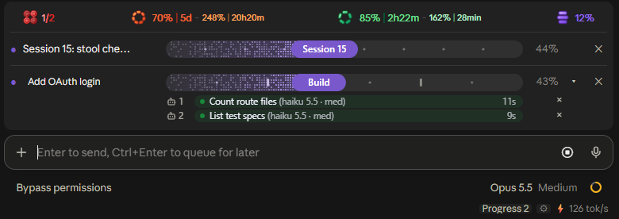
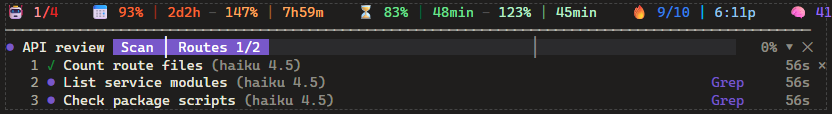

<div align="center">

# 🪑 stool

### **S**tool is **T**ools for **O**rchestration and **O**ptimizing **L**imits

<sub>(Salem's TOOLs)</sub>

[](LICENSE)
[](https://claude.com/claude-code)


**Live progress bars, a usage strip and an agent cap above your Claude Code prompt,<br>so long multi-agent sessions stay visible and stay inside your limits.**



<sub>In the Claude desktop app: usage strip, two plan bars, per-agent rows, and the Progress button and tok/s beside the model.</sub>

</div>

## What you get

- 📊 **Progress bars** that the model keeps itself: staged plans, the active stage as a pill, one row per subagent with its model, tool and time.
- 🚦 **Usage strip**: running agents against the cap, weekly and 5-hour usage with where you are on pace to land, context %, tokens per second.
- 🧮 **Agent cap** that follows your pace, so the model knows how many expensive agents it can run right now.
- 🔥 **Keep-warm**: pings a big idle session so its one-hour prompt cache doesn't go cold while you're away.
- 🔁 **Restart tools**: a clock that says when the context is due a restart, and a tool that clears and resumes the same session.
- 🛡️ **Opt-in guards** for the main conversation, agent dispatch and slow capture tools, all pattern-driven, nothing tied to one project.
- 🧰 **Workflow skills**: project setup (handoff, TODO, fix log), catch-up recaps, adversarial review, arenas, hill-climbing, autonomous runs, handoffs.

It draws in the terminal too:



The generic parts are on as soon as you install it. The guards that carry project-specific rules are off until you switch them on in `/config` (or the progress bars' ⚙ settings window), and their patterns and paths are options.

## Install

```
/plugin marketplace add s66lem/stool
/plugin install stool --marketplace s66lem/stool
```

Answer `y` to add the marketplace, pick a scope, then set the options (every one has a default). Needs Claude Code 2.1.275 or later. The options live in `/config` under the plugin's name and can also be edited in `settings.json` under `pluginConfigs`.

## Parts

| Part | On by default | What it does |
| --- | --- | --- |
| Progress bars (`plan-progress`) | yes | The `plan_progress` tool: the model keeps a staged plan above the prompt, with per-agent strips, a stage pill, times on hover, sounds, and a settings window (the gear in the footer). The terminal bar is a braille track. |
| Usage strip | yes | A strip above the bars: agents used / agent cap, weekly and 5-hour usage with the pace, keep-warm state, context percent, tokens per second. |
| Usage pace (`usage-pace`) | yes | Computes the agent cap from the 5-hour and weekly windows, and toasts when the 5-hour limit would be hit early. Tool `agent_cap`. |
| Keep-warm (`keep-warm`) | yes | Pings a big idle session every 50 minutes so its one-hour prompt cache stays warm, up to 15 pings in a row, only above 100k tokens of context and below 95% of any limit. Command `/keepwarm off\|on\|<count>`. |
| Restart tools (`fresh-restart`) | yes | `restart_session` (`/clear` plus a resume prompt in the same session, once the turn ends) and `reload_plugins`. |
| Restart clock (`restart-clock`) | context part: yes | Says (a note on a tool result, red on the strip) when the main conversation reaches `restartContextAt` percent of context. Opt-in extras: a publish counter and a handoff-file lint. |
| Agent meter (`agent-meter`) | yes | Counts each subagent's tool calls against the cap its prompt states ("about 40 tool calls"), toasts once over it, and appends one line per finished agent to a ledger file. |
| Dispatch guard (`dispatch-guard`) | no | Appends standing orders to every Agent prompt, can require a tool-call cap on prompts matching a pattern, and holds expensive agents to the agent cap across all your sessions (through a shared slot file). |
| Lead guard (`lead-guard`) | no | Denies known slips of the main conversation (not subagents): `git add -A`, `cd` out of the project folder, shell writes to chosen doc paths, check scripts piped to `tail`, plus a nudge after repeated full-size image reads. |
| Capture guard (`capture-guard`) | no | Circuit breaker on a slow screen-capture tool (stops after two failures in a row) and a strip value with free RAM and the count of the watched app's windows. Windows only for the strip. |

## Options

All options are plugin `userConfig` fields. Lists are lists of strings; "regex source" fields take the text of a JavaScript regular expression (an invalid one matches nothing).

| Option | Default | What it does |
| --- | --- | --- |
| `projectRoots` | empty | Folders (with their subfolders) where the folder-scoped parts run: keep-warm, agent-meter, restart-clock, and the guards. Empty = every folder. |
| `doneBarSeconds` | 30 | Seconds a finished progress bar stays while auto-close (`/plan-progress-autoclose`) is on. |
| `twinkle` | true | Animate the dots of the terminal bar while Claude works. |
| `keepWarm` | true | Master switch for keep-warm. |
| `slotFile` | `~/.claude/stool/agent-slots.json` | File shared by all sessions that counts running agents (written by the dispatch guard, read by the usage strip). |
| `agentLedger` | `~/.claude/stool/agent-ledger.tsv` | Tab-separated ledger, one line per finished subagent. |
| `restartContextAt` | 65 | Context percent at which a restart is due. |
| `leadGuard` | false | Turn on the lead guard. |
| `leadGuardDocPaths` | `docs/\|CLAUDE\.md` | Regex source: shell writes to matching paths are denied. Empty = rule off. |
| `leadGuardCheckScripts` | `(check\|merge)\.mjs` | Regex source: piping these scripts through `tail`/`head` without `pipefail` is denied. Empty = rule off. |
| `leadGuardImageNudge` | true | After the 3rd full-size image read, remind the main conversation to hand image checks to a cheaper subagent. |
| `dispatchGuard` | false | Turn on the dispatch guard. |
| `dispatchOrders` | two neutral lines | Lines appended to every Agent prompt (one per line, starting with `- `), followed by a tool-call cap line. |
| `dispatchCapPattern` | empty | Regex source (case-insensitive). A prompt matching it must state a tool-call cap or the spawn is denied, and it also gets `dispatchCapOrders`. Empty = rule off. |
| `dispatchCapOrders` | empty | Extra lines for prompts that match the cap pattern. |
| `dispatchCheapAgents` | empty | Subagent types not counted against the agent cap (any Haiku-model agent never is). |
| `captureGuard` | false | Turn on the capture guard. |
| `captureTool` | empty | Full tool name to watch, for example `mcp__server__screen_capture`. Empty = no breaker. |
| `captureProcess` | empty | Windows process name (no `.exe`) counted for the strip. Empty = no strip value. |
| `restartPublishCounter` | false | Count commands matching `restartPublishPattern`; a restart is due after `restartPublishesAt` of them since the handoff was last rewritten. |
| `restartPublishPattern` | empty | Regex source for the commands to count (a deploy or publish script). |
| `restartPublishesAt` | 3 | Count at which a restart is due. |
| `restartHandoffLint` | false | Warn when a write to the handoff file leaves two heading blocks or a stale `YYYY-MM-DD HH:MMZ` time. |
| `restartHandoffFile` | `HANDOFF.md` | File name the lint and the counter reset watch. |
| `restartHandoffHeading` | `RESUME HERE` | Heading text (after `## `) of the block rewritten on each restart. |
| `restartRewriteCommand` | empty | Regex source for a shell command that rewrites the handoff block (resets the counter like an Edit or Write of it). |

The progress bars' settings window (`/plan-progress-settings`) has a switch for each opt-in part; the patterns and paths are edited in `/config`.

## Commands

`/progress`, `/progress-demo`, `/progress-sounds`, `/progress-clear`, `/progress-agents` (fold or show agent strips), `/plan-progress-autoclose`, `/plan-progress-settings`, `/ribbon` (print what the usage strip sees), `/keepwarm`.

## Tools (for the model)

| Tool | What it does |
| --- | --- |
| `mcp__stool__plan_progress` | Create and move a progress bar. |
| `mcp__stool__agent_cap` | How many Sonnet/Opus-class agents to run in parallel right now, from the pace of the 5-hour and weekly windows. |
| `mcp__stool__restart_session` | `/clear` this session and submit a resume prompt when the turn ends. |
| `mcp__stool__reload_plugins` | Run `/reload-plugins --force` when the turn ends. |
| `mcp__stool__keep_warm` | Turn keep-warm off or on for this session (only registered inside `projectRoots`). |

A subagent's shell commands also get `PLAN_PROGRESS_FILE` set to `~/.claude/stool/plan-progress-runs/<agentId>.json`; a script that writes `{"label","done","total"}` there gets a thin progress bar on that agent's strip while the file is under 30 s old.

## Skills

Manual workflow skills, invoked as `stool:<name>`: `plan-progress` (reference for the bars), `ketchup` (read-only catch-up recap), `correct` (turn repeated mistakes into failing checks), `interrogate` (multi-model adversarial review of a diff), `arena` (N candidates, cross-judged), `autonomous-run` (drive to a checkable end state while you are away), `hillclimb` (tune one metric into a band, one change per measurement), `session-restart` (retrospective, handoff, then `restart_session`), `handoff` (write a continuation document), `project-setup` (add `docs/HANDOFF.md` with one RESUME HERE block, `HANDOFF-history.md`, `TODO.md`, `FIXES.md` and a bookkeeping section in `CLAUDE.md` to a new repo; on a repo with its own CLAUDE.md, notes or TODO files it reviews them and suggests only the missing pieces for you to pick, never overwriting).

### The session loop

`/stool:project-setup` once per repo, then: work → the strip turns the context red (or the publish counter trips) → `/stool:session-restart` writes the retrospective and the handoff and clears into a fresh session that reads `RESUME HERE` and carries on. Long projects run for days this way without autocompact losing the thread.

## State and files

Plugin state (`$.state`, plugin `stool`): `plans`, `isOpen`, `tick`, `speed`, `prefs` (the bars); strip values `usage`, `warm`, `restart`, `meter`, `capture`. Files the plugin writes, all under `~/.claude/stool/`: `agent-slots.json`, `agent-ledger.tsv`, `plan-progress-runs/`.

## Tests

`claude plugin validate .` and `claude plugin test .` (a combined smoke test); `node tests/run-specs.mjs` runs each part's `hooks/<part>/register.spec.ts` alone; the progress bars' offline suite is described in `tests/plan-progress/README.md`.

## Notes

The engine allows one hooks module and refuses two matcherless hooks on one event, so colliding hooks carry an always-true regex matcher (`/[^]*|a{N}/` on a key every such event has) to stay distinct.

## Credits and license

MIT, see `LICENSE`. The progress bars are ported from zycck's plan-progress (Kirill Serditov, https://github.com/zycck/claude-mods); the `ketchup`, `correct`, `interrogate`, `arena`, `autonomous-run` and `hillclimb` skills are adapted from Lauren Tan's pstack (https://github.com/cursor/plugins/tree/main/pstack); the keep-warm loop follows karanb192/cache-tax.
